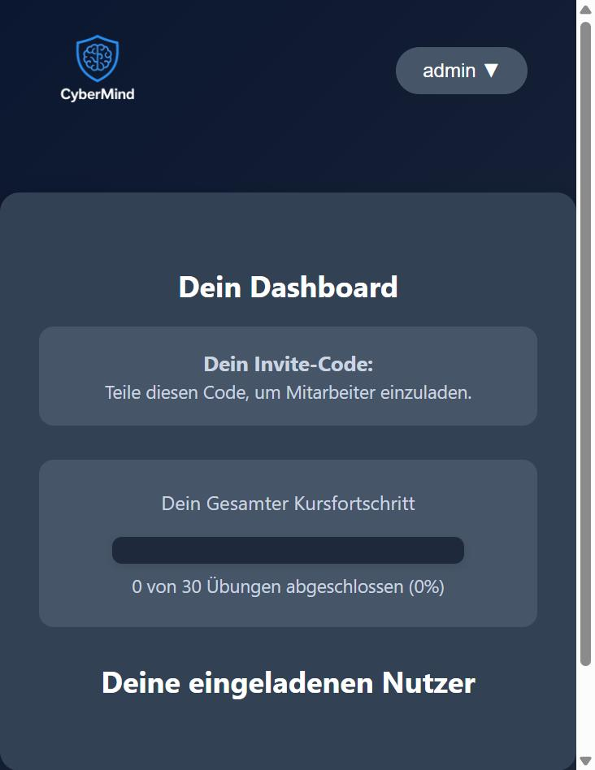
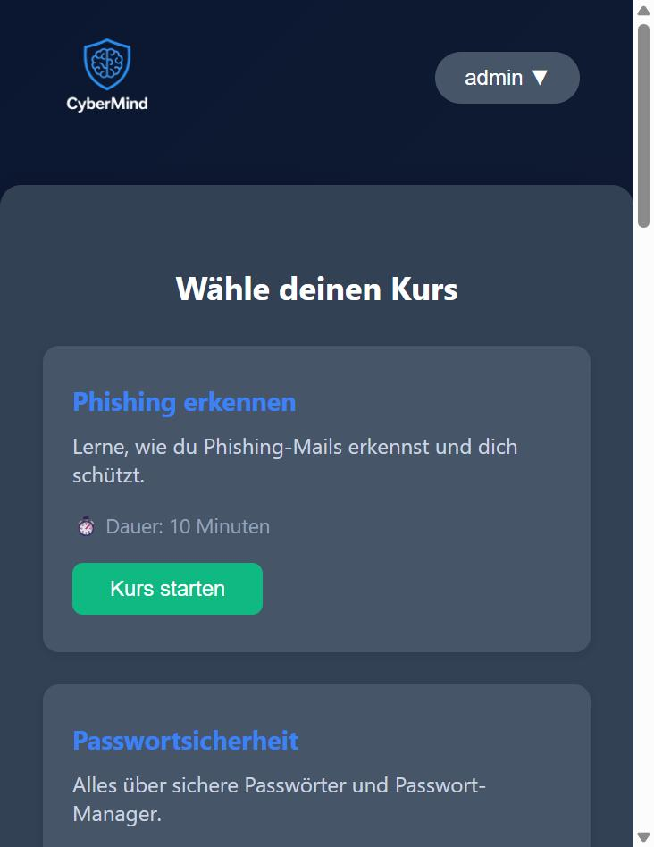
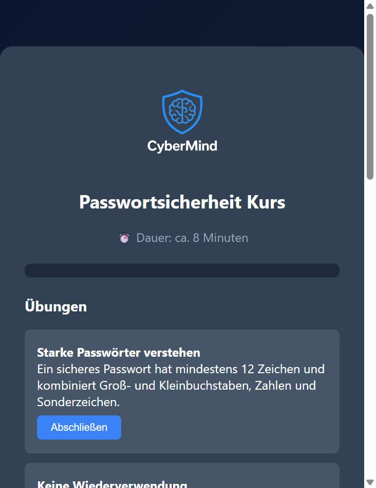

# Cyber Mind

Lernplattform für IT-Sicherheit. Nutzer arbeiten Kurse zu verschiedenen
Security-Themen durch, lösen Übungen und Quizze und sammeln Punkte, die im
Dashboard ausgewertet werden. Konten gibt es als Einzel-, Business- und
Schulzugang; Abos werden über PayPal abgewickelt.

## Screenshots

| Startseite | Dashboard |
|------------|-----------|
|  |  |

| Kursauswahl | Kursansicht |
|-------------|-------------|
|  |  |

## Kurse

- Passwortsicherheit
- Phishing
- Malware
- Social Engineering
- Social Media
- Mobile Security
- Cloud Security
- Datenschutz
- Sicheres Surfen

Jeder Kurs enthält Theorie, interaktive Übungen und ein abschließendes Quiz.

## Funktionen

- Registrierung als Solo-, Business- oder Schulkonto sowie Einladungs-Codes
- Login mit gehashten Passwörtern
- Fortschritts- und Punkteübersicht im Dashboard
- Rollen (z. B. Owner für Business-Konten)
- PayPal-Abo für Solo- und Business-Pläne

## Technik

PHP und MySQL (mysqli), HTML, CSS und JavaScript, PayPal JavaScript SDK.

## Einrichtung

1. Projekt in das Web-Root des Servers kopieren (z. B. `C:\xampp\htdocs\cybermind`).
2. Datenbank `cybermind` anlegen und `datenbank/schema.sql` importieren.
   Die Zugangsdaten lassen sich über die Umgebungsvariablen `DB_HOST`,
   `DB_USER`, `DB_PASS`, `DB_NAME` setzen; ohne Variablen gelten die lokalen
   Standardwerte aus `db.php` (`localhost`, `root`, kein Passwort, `cybermind`).
3. In `payment_solo.php` und `payment_business.php` den Platzhalter
   `YOUR_PAYPAL_CLIENT_ID` durch die eigene PayPal-Client-ID ersetzen.
4. Projekt im Browser aufrufen. Test-Login: `admin` / `changeme`.

## Datenbank

`datenbank/schema.sql` enthält die komplette Tabellenstruktur mit etwas
Beispielinhalt (ein Admin-Konto sowie je Kurs einige Übungen und Quizfragen).
Das Schema besteht aus der `users`-Tabelle und pro Kurs vier Tabellen nach dem
Muster `<kurs>_exercises`, `<kurs>_exercise_user`, `<kurs>_quiz`,
`<kurs>_quiz_user`. Das produktive Schema lag auf dem Hosting; diese Vorlage
wurde aus dem Code nachgebaut, damit das Projekt lokal lauffähig ist.
